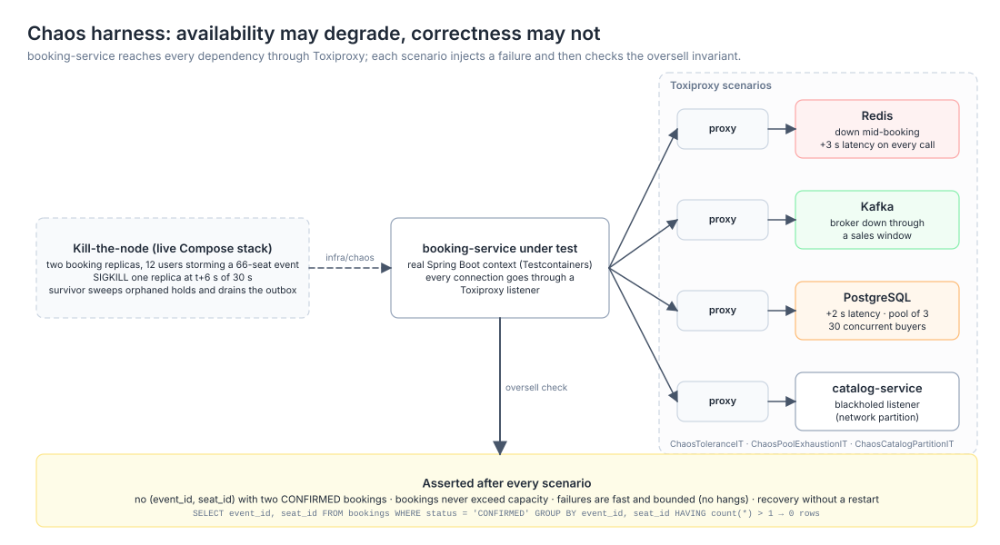

# Verification: chaos and load results

The system's contract under failure is that availability may degrade but
correctness may not. "Correctness" here is one invariant, a seat is never sold
twice and sales never exceed capacity, plus its supporting guarantees: holds
always expire, and committed events are always eventually delivered, exactly
once in effect.

Three harnesses exercise this contract:

1. **Toxiproxy chaos suite** (`booking-service`, `ChaosToleranceIT`,
   `ChaosPoolExhaustionIT`, `ChaosCatalogPartitionIT`; runs in CI). It injects
   the failures below between booking-service and its dependencies, then asserts
   that `SELECT ... FROM bookings WHERE status = 'CONFIRMED' GROUP BY event_id,
   seat_id HAVING count(*) > 1` returns nothing and that booked seats never
   exceed capacity.
2. **Kill-the-node test** (`infra/chaos/kill_node_test.py`; manual, needs the
   live Compose stack). It sends SIGKILL to one of two booking replicas
   mid-transaction under load.
3. **k6 load tests** (`infra/k6/`; manual, against the live Compose stack
   through the gateway).



## 1. Failure matrix (measured)

| Failure injected | Availability impact (measured, tolerated) | Correctness (asserted) |
|---|---|---|
| Redis fully down mid-booking | In-flight confirms: 6 of 6 succeeded during the outage (the database is authoritative). New holds failed fast and clean (5xx in 12 to 18 ms, bounded by a 4.5 s Lettuce command timeout, no hangs). Holds recovered without a restart when Redis returned | Held, zero oversell |
| Redis +3 s latency on every call | All 12 concurrent requests completed within the command timeout; 4 hold-and-confirm pairs succeeded slowly, rivals got clean 409s | Held, zero oversell |
| Kafka broker down (about 16 s window; the 60 s semantics are preserved through multi-cycle relay retries) | 3 of 3 bookings returned 201 quickly (slowest confirm 12 ms). Events parked in the outbox (attempts of 2 or more observed) and all were delivered after the restore; nothing lost | Held |
| PostgreSQL pool exhausted (pool of 3, +2 s database latency, 30 concurrent buyers) | Load shed: 2 responses of 201, 28 clean 5xx, zero hangs; normal booking resumed immediately after the toxic was removed | Held, zero oversell |
| Network partition between booking and catalog | Unseeded events degraded to a clean 503 problem detail (real Feign path). Already-seeded events booked normally throughout the partition | Held |
| SIGKILL of a booking replica under load (measured 2026-07-16: 12 users storming a 66-seat event, kill at t+6 s of 30 s) | 36 failed requests during failover; the gateway's connection pool stayed pinned to the dead IP for 1 to 2 minutes before evicting it (self-healed; future work: a gateway retry-on-connect-failure filter). The survivor kept serving throughout | Held: 46 bookings, 0 double-booked seats, orphaned holds swept by the survivor within TTL plus one sweep, outbox fully drained |

## 2. Why correctness survives each case

- **Redis loss** can only remove the fast-path seat claim. The confirm
  transaction re-verifies the hold from PostgreSQL and the `@Version`
  optimistic lock admits exactly one `AVAILABLE → BOOKED` transition. Redis is
  never consulted for the final decision.
- **Kafka loss** never touches the request path. Events commit to the outbox in
  the booking transaction; the relay delivers them when the broker returns
  (at-least-once delivery plus consumer dedupe gives an exactly-once effect).
- **PostgreSQL degradation** degrades everything, by design. When the source of
  truth is unavailable the correct behaviour is to fail requests, not to guess.
  Timeouts and 5xx responses are the accepted cost; no state is written outside
  PostgreSQL transactions, so nothing can diverge.
- **Catalog partition** only blocks first-touch inventory seeding (503 with a
  clear message). Already-seeded events sell normally; booking keeps its own
  copy of seat inventory precisely so that catalog is not a runtime dependency
  of the sale.
- **Replica death**: holds orphaned by the dead node expire by their database
  timestamps (the survivor's sweeper claims them with `SKIP LOCKED`); outbox
  rows claimed by the dead node unlock when its connections die and the
  survivor's relay publishes them. Nothing about the invariant lives in process
  memory.

## 3. Load tests (k6)

Measured on 2026-07-16 on a single Apple Silicon laptop running the full Docker
Compose stack (six services plus PostgreSQL, Redis and Kafka), with k6 in a
container on the Compose network. All traffic goes through the API gateway, so
every request pays the gateway hop, the edge JWT filter and the Redis rate
limiter (raised to 2,000 requests per second for these runs through
`RATE_LIMIT_REPLENISH`, so the services are measured rather than the limiter).
The numbers show the relative behaviour of the cache and hold layers on
laptop-class hardware, not production capacity.

### 3.1 Read path: catalog browse (`infra/k6/browse-load.js`)

One iteration is an event search, an event detail read and a seat-map read.
Two datasets were used: the small seeded events, and a deliberately heavy
7,200-seat event ("Mega Arena", 393 KB seat-map response) created through the
organizer API. The cache is toggled with `CATALOG_CACHE_ENABLED`.

| Scenario | Throughput | detail p95 | seat map p50 | seat map p95 | Errors |
|---|---|---|---|---|---|
| Small events, cache on, 30 VUs | 148 req/s | 4.2 ms | 1.1 ms | 3.9 ms | 0 |
| Small events, cache off, 30 VUs | 148 req/s | 3.3 ms | 1.2 ms | 2.9 ms | 0 |
| Mega Arena, cache off, 100 VUs | 494 req/s | 1.8 ms | 1.8 ms | 3.2 ms | 0 |
| Mega Arena, cache on, 100 VUs | 491 req/s | 2.4 ms | 3.0 ms | 5.7 ms | 0 |
| Mega Arena, cache off, 300 VUs | 1,473 req/s | n/a | 1.9 ms | 5.7 ms | 0 |
| Mega Arena, cache on, 300 VUs | 1,462 req/s | n/a | 3.5 ms | 14.7 ms | 0 |

At this scale the cache-aside layer does not lower read latency; it slightly
raises it on the largest responses. The uncached read is cheap because the
seat map is derived from about 30 section rows, never per-seat rows, so "no
cache" is a small indexed query on a warm local database plus in-memory
expansion (about 2 ms even for 7,200 seats). The cached read moves a 393 KB
JSON blob across the Redis connection and deserializes it before responding,
and for big values that transfer is the latency.

Cache-aside pays when the underlying read is expensive: contended connection
pools, complex joins, cold pages, a network-distant or replica-lagged database,
or thundering-herd reads during on-sale spikes. A warm, idle, localhost
PostgreSQL exhibits none of these. The layer is kept, and toggleable, because
its purpose here is headroom and isolation rather than laptop latency: with the
cache on, a hot event's reads put no load on the database that is
simultaneously processing booking writes, so Hikari's 10-connection pool never
competes with the on-sale traffic. Two follow-ups would make it strictly
better and are noted as future work: store the serialized response bytes and
serve them without re-parsing, and only cache seat maps below a size threshold
(large values belong behind a CDN or ETag, not in Redis).

### 3.2 Write path: booking storm (`infra/k6/booking-storm.js`)

50 users (each registered through the API in setup) run 3 iterations each,
racing to hold and immediately confirm seats of one 44-seat workshop event
through the gateway. This is the Testcontainers race test replayed over real
HTTP against the live stack.

| Metric | Value |
|---|---|
| Purchase attempts (hold then confirm) | 150 |
| Bookings confirmed | 44, exactly the seat count; the event sold out |
| Clean seat conflicts (409) | 74 |
| Server errors (5xx) | 0 |
| Oversold seats | 0 |
| Request latency p50 / p90 / p95 | 67 ms / 204 ms / 632 ms |

The p95 tail is the inventory-seeding stampede: the first holds trigger a
one-time Feign fetch of the seat map from catalog plus 44 inserts, guarded by a
Redisson lock that 50 concurrent VUs pile up behind. After seeding,
hold-and-confirm settles around the median (about 67 ms for the full
two-request sequence). Losers fail in milliseconds because the Redis `SET NX`
gate rejects them before any database transaction starts.

Also verified live, separately: with Kafka and notification-service stopped,
hold and confirm still returned `201 CONFIRMED` in 70 ms. The request path never
touches Kafka (events are written to the transactional outbox inside the
booking transaction and relayed once the broker returns), so the messaging tier
cannot block a sale.

### 3.3 Why the hold layer matters although the optimistic lock is the guard

Without holds, all 150 contenders would open booking transactions and 106 would
lose at commit time inside PostgreSQL (version conflicts): wasted round trips
and row contention exactly when the system is busiest. With the Redis `SET NX`
hold as the first gate, at most one contender per seat reaches the database;
the `@Version` optimistic lock runs essentially uncontended and exists for
correctness (Redis failover and flush scenarios), not throughput. The 74
rejections above cost a sub-millisecond cache operation each.

## 4. Reproducing

### Kill-the-node test

```bash
docker compose -f docker-compose.yml -f infra/chaos/docker-compose.chaos.yml \
  up -d --build --scale booking-service=2
# wait for health, then:
python3 infra/chaos/kill_node_test.py
# restore the normal topology afterwards:
docker compose up -d --remove-orphans
```

### Load tests

```bash
docker compose up -d --build

# read path (heavy event): create it once via the organizer API, then
RATE_LIMIT_REPLENISH=2000 RATE_LIMIT_BURST=4000 docker compose up -d api-gateway
CATALOG_CACHE_ENABLED=false docker compose up -d catalog-service   # baseline
docker run --rm -i --network seatsync_default -e BASE_URL=http://api-gateway:8080 \
  -e VUS=100 -e QUERY=Mega grafana/k6 run - < infra/k6/browse-load.js
docker compose up -d catalog-service                               # cache back on
docker run --rm -i --network seatsync_default -e BASE_URL=http://api-gateway:8080 \
  -e VUS=100 -e QUERY=Mega grafana/k6 run - < infra/k6/browse-load.js

# write path
docker run --rm -i --network seatsync_default -e BASE_URL=http://api-gateway:8080 \
  -e EVENT_ID=<uuid-of-a-small-event> grafana/k6 run - < infra/k6/booking-storm.js

docker compose up -d api-gateway   # restore default rate limits
```
